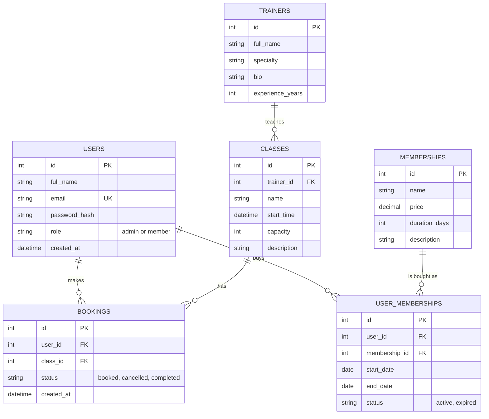

# GymHub - Entity Relationship Diagram (draft)

## Relationships

| Relationship | Type | Description |
|---|---|---|
| users - user_memberships | 1:N | A user can have many purchased memberships |
| memberships - user_memberships | 1:N | A membership plan is bought by many users |
| trainers - classes | 1:N | A trainer teaches many classes |
| users - bookings | 1:N | A user makes many bookings |
| classes - bookings | 1:N | A class has many bookings |
| users - classes | N:M | Resolved through bookings |
| users - memberships | N:M | Resolved through user_memberships |

## Notes
- The Exercises page uses an external API, so exercises are not stored in the database.
- A user cannot book the same class twice (unique pair user_id + class_id in bookings).
- Passwords are stored as hashes, never as plain text.